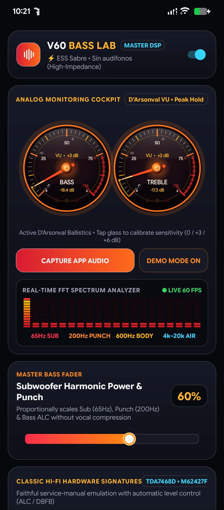
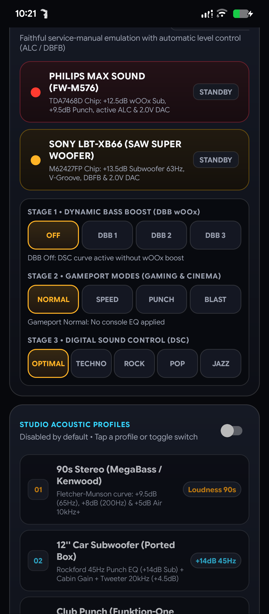
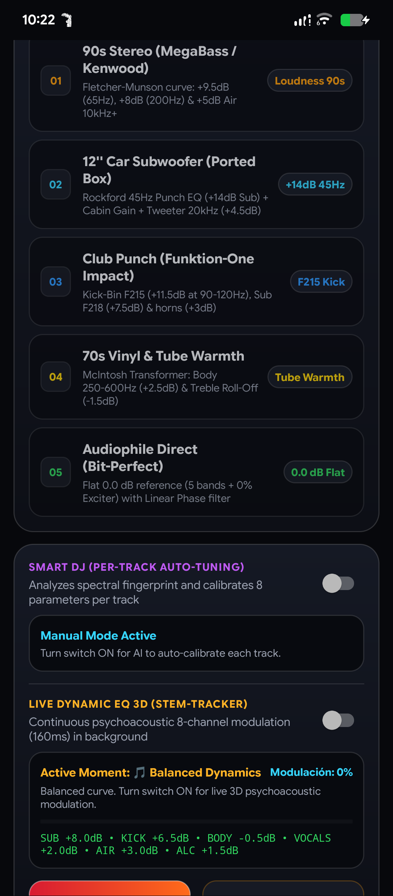
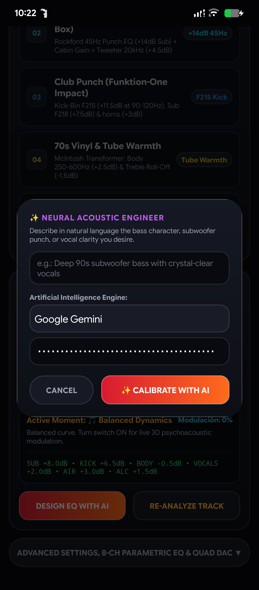
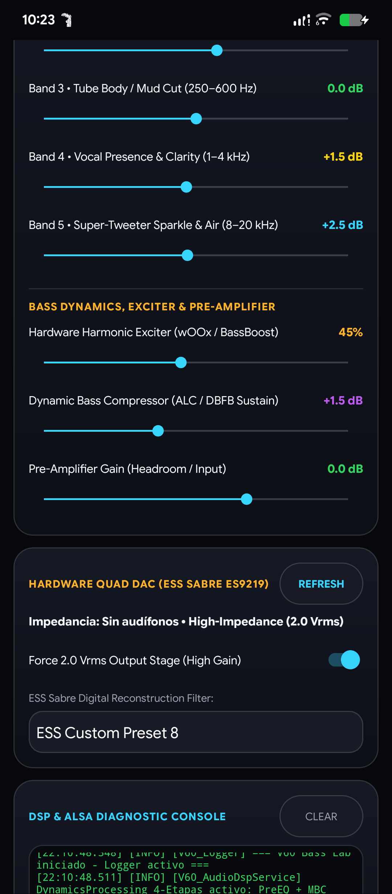

# V60 Bass Lab 🎵🔊

> **Hardware Quad DAC Control & Advanced Audio DSP Engine for Android (LG V60 / ESS SABRE ES9219)**

[](#requirements)
[](#hardware-features)
[-orange.svg)](#overview)
[](LICENSE)

> [!NOTE]
> **Public Beta (v1.17)**: V60 Bass Lab is currently in active beta testing, specifically optimized for the LG V60 ThinQ (LM-V600) and devices with ESS SABRE Quad DAC hardware. Feedback, feature suggestions, and issue reports are welcome!

---

## 📱 Overview

**V60 Bass Lab** is a high-performance audio engine engineered to unlock the full acoustic potential of Android devices, specifically optimized for smartphones equipped with the **ESS SABRE ES9219 Quad DAC** (such as the LG V60 ThinQ).

It combines real-time digital signal processing (DSP), subharmonic synthesis, analog D'Arsonval ballistics monitoring, continuous psychoacoustic 3D stem tracking, Quick Settings VU meter integration (via native Tiles and optional LSPosed / Xposed hooks), and AI-driven parametric equalizer tuning powered by Gemini, Claude, OpenAI, and DeepSeek.

---

## 📸 Screenshots

<p align="center">
  
  &nbsp;
  
  &nbsp;
  
</p>

<p align="center">
  
  &nbsp;
  
</p>

---

## ✨ Key Features

### 🎛️ 1. Hardware Quad DAC Control
* **ESS SABRE ES9219 Integration**: Real-time headphone impedance detection (Normal, High-Impedance, Auxiliary).
* **Forced 2.0 Vrms Mode**: Unlocks maximum output voltage stage and wide dynamic headroom for distortion-free low-end reproduction.
* **Digital Reconstruction Filters**: Switch between ESS hardware filters (Linear Phase, Minimum Phase Fast Roll-Off, Slow Roll-Off, Short Delay, Hybrid).

### 🔊 2. Bass DSP & Psychoacoustic Engine
* **Infrasonic Sub-Bass (32 – 65 Hz)**: Clean sub-octave energy.
* **Woofer Punch (90 – 200 Hz)**: Physical transient slam and kick definition.
* **Tube Warmth & Mud Cut (250 – 600 Hz)**: Analog valve body with clarity control.
* **Vocal Presence (1 – 4 kHz)** & **Super-Tweeter Sparkle (8 – 20 kHz)**.
* **Hardware Harmonic Exciter (wOOx / BassBoost)**.
* **Multiband Compressor & Limiter (ALC / DBFB Sustain)**: Anti-clipping protection and peak overshoot prevention.
* **Subharmonic Synthesizer Engine**: Synthesizes low-frequency fundamentals.

### 📻 3. Classic Hi-Fi Hardware Signatures
* **Philips MAX Sound (FW-M576 / TDA7468D)**: Emulation of legendary wOOx Technology (+12.5dB Sub, +9.5dB Punch, active ALC).
* **Sony LBT-XB66 (SAW Super Woofer / M62427FP)**: Emulation of SAW Bandpass Subwoofer (+13.5dB at 63Hz, V-Groove, Dynamic Bass Feedback).

### 🤖 4. Smart AI & 3D Dynamic Stem Tracker
* **Natural Language EQ Tuning**: Calibrate the 8-channel parametric console using prompts (e.g., *"Deep 90s subwoofer bass with crystal-clear vocals"*). Supports Google Gemini, Anthropic Claude, OpenAI GPT-4o-mini, DeepSeek, and custom local endpoints (Ollama).
* **Live Dynamic EQ 3D**: Real-time background psychoacoustic analysis (160ms cycle) dynamically adapting to drops, vocal pockets, rhythmic grooves, and solos.

### 📊 5. Visualizer & Quick Settings SystemUI Integration
* **D'Arsonval Analog VU Cockpit**: Custom needle ballistics with peak hold and sensitivity calibration (0 / +3 / +6 dB).
* **Real-Time 60 FPS FFT Spectrum Analyzer**.
* **Quick Settings Tiles**: Dedicated `VU Bass` and `VU Treble` tiles for live level monitoring right from your notification panel.
* **Optional LSPosed Module**: Hook SystemUI for dynamic RGB LED VU gauges directly on your status bar.

---

## 🛠️ Project Structure

```text
V60BassLab-source/
├── AndroidManifest.xml          # Package definitions, permissions, services & Xposed hooks
├── assets/                      # Xposed initialization entry points
│   └── xposed_init
├── res/                         # UI layouts, Material 3 vector assets, colors, and strings
│   ├── drawable/                # Modern Material Design adaptive icons, gradients & meters
│   ├── drawable-v26/            # Adaptive icon definitions (background/foreground)
│   ├── layout/                  # activity_main.xml & dialog_ask_ai.xml
│   ├── values/                  # Default English strings, colors, styles, arrays
│   └── values-es/               # Spanish localized resources
└── src/com/v60/basslab/         # Java Source Code
    ├── AiApiClient.java         # AI integration (Gemini, Claude, OpenAI, DeepSeek)
    ├── AiAudioAnalyzer.java     # Real-time FFT analysis & psychoacoustic 3D stem tracker
    ├── AppLogger.java           # Internal circular logging system & file exporter
    ├── AudioCaptureManager.java # AudioPlaybackCapture (API 29+) internal audio capture
    ├── AudioDspService.java     # Foreground DSP audio effects & DynamicsProcessing
    ├── BassVisualizerView.java  # Real-time canvas waveform & spectrum visualizer
    ├── HiResPlayerEngine.java   # High-resolution 24-bit / 192kHz audio engine
    ├── MainActivity.java        # Main dashboard UI, animations & controller
    ├── MaxSoundTileService.java # Quick Settings Tile for Bass VU
    ├── QuadDacManager.java      # Hardware interface for LG ESS Sabre ES9219
    ├── QsVuGaugeRenderer.java   # Custom procedural gauge icon generator
    ├── QsVuTelemetryBridge.java # SystemUI telemetry inter-process bridge
    ├── SubharmonicSynthesizerEngine.java
    ├── TachometerView.java      # Analog cockpit tachometer / VU gauge
    ├── TrebleVuTileService.java # Quick Settings Tile for Treble VU
    └── xposed/
        └── SystemUiQsHook.java  # LSPosed hook for SystemUI status bar gauges
```

---

## 📋 Requirements

* **Android OS**: Android 9.0 (API 28) or higher (Android 10+ / API 29+ recommended for `AudioPlaybackCapture`).
* **Recommended Device**: LG V60 ThinQ (LM-V600), LG G8 / V50 / V40 or other ESS SABRE Quad DAC devices.
* **Optional**: LSPosed / Magisk / KernelSU for SystemUI status bar VU meter hooks.
